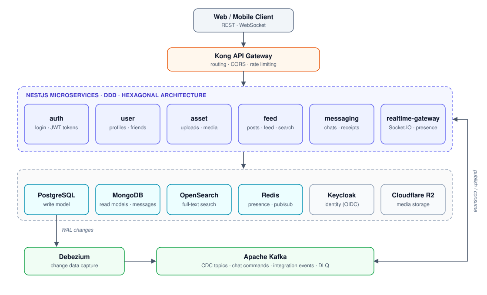

# Social Chat — Backend

Backend for a social network with real-time chat, built as **NestJS microservices** in a TypeScript monorepo.

**Features:** auth · profiles & friends · posts, comments, reactions & news feed · search · media uploads · 1:1 and group chat with presence, typing and read receipts.

## Highlights

- **Microservices** behind a **Kong API Gateway**, sharing code through Yarn workspaces
- **DDD + Hexagonal Architecture:** the domain layer has no framework code
- **CQRS with CDC:** writes go to PostgreSQL, and **Debezium → Kafka** keeps the MongoDB and OpenSearch read models in sync
- **Scalable WebSockets:** stateless Socket.IO gateways, with fan-out over **Redis pub/sub**
- **Multi-device presence:** an atomic **Redis Lua script** with heartbeats and a reconnect grace period
- **Reliable messaging:** idempotent message IDs, acks, read watermarks and a Kafka **dead-letter queue**

## Architecture



| Service | Responsibility |
|---|---|
| **auth** | Login, JWT access/refresh tokens, Keycloak (OIDC) |
| **user** | Profiles, friendships, blocking, suggestions, user search |
| **asset** | Pre-signed and multipart uploads to R2, image resizing, video transcoding |
| **feed** | Posts, comments, reactions, feed, full-text search |
| **messaging** | Conversations, message history, read receipts |
| **realtime-gateway** | WebSocket connections, sending messages, typing, presence |

**Shared packages:** `domain` (entities, value objects, events) · `infrastructure` (DB, Kafka, Redis adapters) · `common` (config, base classes) · `libs` (auth guards)

## How a message is delivered

1. The client sends `message:send` over WebSocket.
2. The gateway publishes the message to **Kafka**.
3. The messaging service checks membership, then saves the message to **MongoDB**.
4. The event goes out on **Redis pub/sub**, and every gateway instance pushes it to the room.

## Tech Stack

**TypeScript · NestJS · PostgreSQL · MongoDB · Redis · Kafka · Debezium · OpenSearch · Socket.IO · Kong · Keycloak · Cloudflare R2 · Docker**

## Getting Started

**Prerequisites:** Node.js 22, Yarn 4, Docker. Fill in the env files under `config/` (they are git-ignored).

```bash
bash scripts/setup.sh    # install deps, start infra, configure Kong + Debezium
yarn migration:run       # create the database schema
yarn auth:dev            # also: user:dev, asset:dev, feed:dev, messaging:dev, gateway:dev
```

The API is served at `http://localhost:3000` (Kong) and Kafka UI at `http://localhost:8081`.

## Quality

```bash
yarn typecheck && yarn lint && yarn format:check
```

## Design Decisions

- **CDC over dual writes:** writing to the database and to Kafka separately can lose events; Debezium reads the committed changes, so none are missed.
- **Kafka between gateway and messaging:** absorbs traffic spikes and keeps message order within each conversation.
- **Redis pub/sub:** delivers to a user no matter which gateway instance holds their socket.
